<div align="center">

# Ninety

**Count your Schengen 90/180 days, check them against the EU's new Entry/Exit System, and draft the correction letter when the border's count is wrong.**

**[ninety-coral.vercel.app](https://ninety-coral.vercel.app)** · [EES check](https://ninety-coral.vercel.app/ees) · [Article 52 letter](https://ninety-coral.vercel.app/letter) · [Commission parity](https://ninety-coral.vercel.app/parity) · [Proof](https://ninety-coral.vercel.app/proof) · [API](https://ninety-coral.vercel.app/developers)

[](https://github.com/mohamedwael201193/ninety/pull/70/checks) [](https://github.com/mohamedwael201193/ninety/actions/runs/40149772752) [](docs/evidence/mutation/summary.json) [](https://github.com/mohamedwael201193/ninety/actions/workflows/ci.yml) [](https://ninety-coral.vercel.app/parity) [](src/lib/schengen/deep/deep.test.ts) [](#running-locally) [](LICENSE)

</div>

<p align="center">
  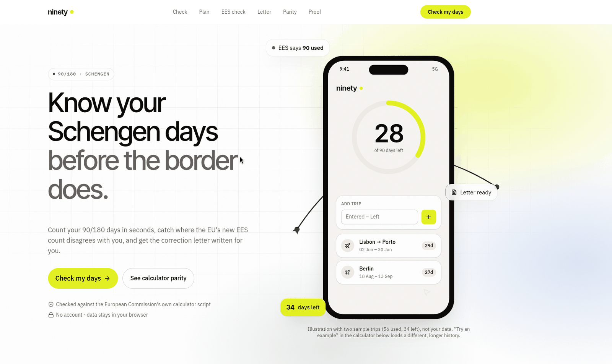
  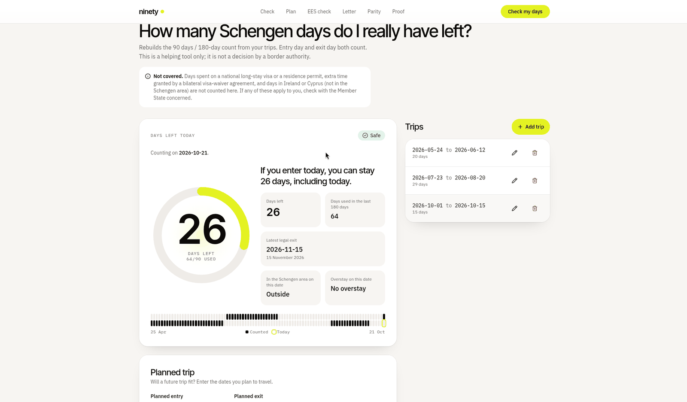
</p>
<p align="center">
  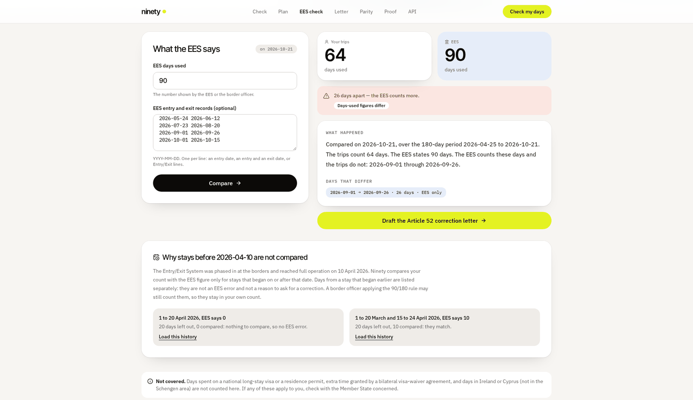
  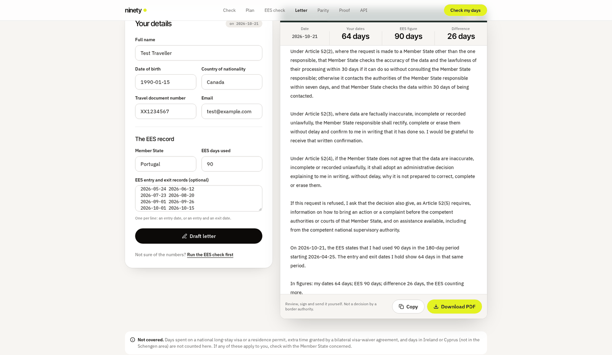
  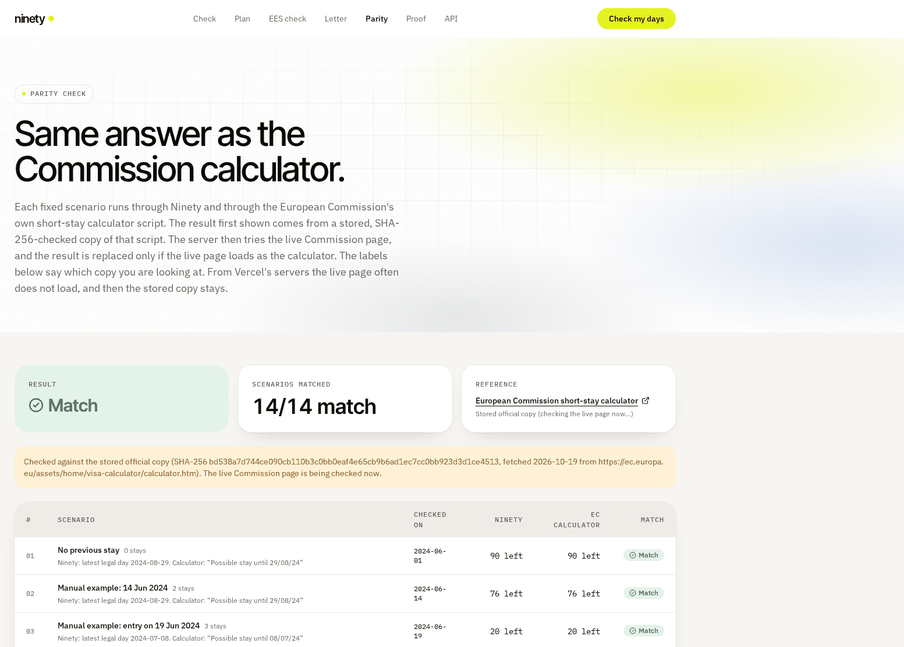
</p>

## Judge path (2 minutes)

Each line is something you can check yourself, with the command or link that proves it.

1. **Merge gate, fail closed.** `curl -s https://api.github.com/repos/mohamedwael201193/ninety/branches/main | jq .protection` lists the 7 required checks on `main`, enforced for admins too. One is `TestSprite N/N gate`: it reads the real count from the `TestSprite V3` status and the backend run on the same commit and fails unless both are N/N, N > 0, or if either result is missing or unreadable ([`docs/NN-GATE.md`](docs/NN-GATE.md), tested on recorded payloads from our own PRs).
2. **TestSprite on every PR.** Open any recent merged PR, then the Checks tab: `TestSprite V3` (54 frontend tests on the PR's Vercel preview, GitHub App) and `TestSprite backend (30 API tests)` (CLI, [`testsprite-backend.yml`](.github/workflows/testsprite-backend.yml)).
3. **Red runs are triaged on the PR.** When the backend gate fails, the workflow comments on the PR with each failing test, a first-guess cause, TestSprite's error line, the run id and a one-line reproduce command ([`triage.mjs`](scripts/ci/triage.mjs), tested in [`triage.test.ts`](src/lib/ci/triage.test.ts)). It only reads the gate's own results file; no results means the comment says no test ran.
4. **Nightly on production.** [`testsprite-smoke.yml`](.github/workflows/testsprite-smoke.yml) runs TS01, TS03, TS07, and TS62 and TS39 (phone width, CLI only) every night (2.5 credits). Every finished run is a comment on the [Run log issue](https://github.com/mohamedwael201193/ninety/issues?q=label%3Atestsprite-log), and a red night opens a [`testsprite-red` issue](https://github.com/mohamedwael201193/ninety/issues?q=label%3Atestsprite-red).
5. **Red then green, counted.** [`docs/DEFECTS.md`](docs/DEFECTS.md): one row per red-then-green PR (13), with the red and green `TestSprite V3` status of each commit as public GitHub API links, and the 7 real bugs named. Full log: [`LOOP-ITERATIONS.md`](LOOP-ITERATIONS.md), generated from the GitHub API by `node scripts/loop-iterations.mjs`.
6. **The answer is the official one.** [`/parity`](https://ninety-coral.vercel.app/parity): 14/14 scenarios against the European Commission calculator; deep parity 399/400, and the one difference is explained in [`docs/PARITY-399.md`](docs/PARITY-399.md). Each rule on [`/proof`](https://ninety-coral.vercel.app/proof) cites its article on EUR-Lex (Regulation (EU) 2016/399 Art. 6(1) and 6(2), 2017/2226 Art. 12(1) and 52, 2025/1534 Art. 2(1) and 5(6)).
7. **Locally:** `npm ci && npm test` → 408 passing, 3 skipped.
8. **Independent reference and mutation score.** `REF_CASES=1200 npx vitest run src/lib/schengen/reference-rule.test.ts` (1,200 generated cases vs a reference written from the regulation, all agree); `npm run mutation` (Node 22, about an hour) → 94.47% combined on the engine (full run 87.44%, then a targeted rerun after new tests), details in [`docs/evidence/mutation/`](docs/evidence/mutation/summary.json).
9. **Screenshots of the gates, the red run and its fix:** [`docs/evidence/pr65-67/`](docs/evidence/pr65-67/README.md); the final 54/54 and 30/30 runs: [`docs/evidence/pr68/`](docs/evidence/pr68/README.md).
10. **On the site:** the numbers below are on the [home page](https://ninety-coral.vercel.app/#verified) and on [`/proof`](https://ninety-coral.vercel.app/proof), each linking its source ([`verification.json`](src/data/verification.json), checked against the suites and CI by [`VerifiedNumbers.test.ts`](src/components/proof/VerifiedNumbers.test.ts)).

## What it does

A non-EU traveller may spend at most 90 days in any rolling 180-day period in the Schengen area. Since 10 April 2026 the EU Entry/Exit System (EES) records every crossing and shows its own days-used figure, and a missing exit record can make that figure badly wrong. Ninety:

1. **Counts** your days from the trips you enter: used and left on any date, the latest legal exit, whether a planned trip fits, and any overstay ([`/`](https://ninety-coral.vercel.app)).
2. **Checks the EES figure** against your trips, names the likely cause (missing exit, missing entry, exit dates that disagree) and lists the exact days that differ ([`/ees`](https://ninety-coral.vercel.app/ees)).
3. **Drafts the Article 52 request** (Regulation (EU) 2017/2226) to rectify, complete or erase the EES data, carrying over the figure and records from the EES check, as text or PDF ([`/letter`](https://ninety-coral.vercel.app/letter)).
4. **Shows it gives the official answer**: 14 scenarios run through Ninety and the European Commission's own calculator script side by side ([`/parity`](https://ninety-coral.vercel.app/parity)).
5. **Is an API and MCP server** for agents: three endpoints and three MCP tools from the same engine ([`/developers`](https://ninety-coral.vercel.app/developers)).

No account. Trips stay in your browser.

## How TestSprite proves it

**At a glance** (as of PR #70, merged 2026-10-25 as [`d787b01`](https://github.com/mohamedwael201193/ninety/commit/d787b01a438bb46e7094a5b38f0128fe4a3cb842)):

| | Number | Source |
|---|---|---|
| TestSprite end-to-end (GitHub App, PR preview) | **54/54** passed | [PR #70 checks](https://github.com/mohamedwael201193/ninety/pull/70/checks) (`TestSprite V3`: "All 54 tests passed" on `c62fdd5`) |
| TestSprite API and MCP (CLI, PR preview) | **30/30** passed | [run 40149772752](https://github.com/mohamedwael201193/ninety/actions/runs/40149772752) |
| Required checks on `main` | **7**, admins included, PR required, one a fail-closed TestSprite N/N gate | [`docs/NN-GATE.md`](docs/NN-GATE.md) |
| Triage comment on a red backend run | each failing test, cause, run id, rerun command | [`triage.mjs`](scripts/ci/triage.mjs) |
| Red, then green on a PR | **14** PRs (6 app defects with 7 real bugs, 1 UX, 7 test plan or CI) | [`docs/DEFECTS.md`](docs/DEFECTS.md) |
| Nightly on production | **5** tests (TS01, TS03, TS07; TS62 and TS39 at phone width); a red night opens an issue | [`testsprite-smoke.yml`](.github/workflows/testsprite-smoke.yml), [#66](https://github.com/mohamedwael201193/ninety/issues/66) |
| Independent reference of the rule | **1,200** per PR, **20,000** nightly | [`reference-rule.test.ts`](src/lib/schengen/reference-rule.test.ts) |
| Fuzz against the Commission script | **5,000** per PR, **20,000** nightly | [`differential.fuzz.test.ts`](src/lib/schengen/differential.fuzz.test.ts) |
| Mutation score (engine) | **94.47%** combined (full run 87.44%, then targeted rerun) | [`summary.json`](docs/evidence/mutation/summary.json) |
| Vitest | **408** passing, 3 skipped | `npm test` |

<p align="center">
  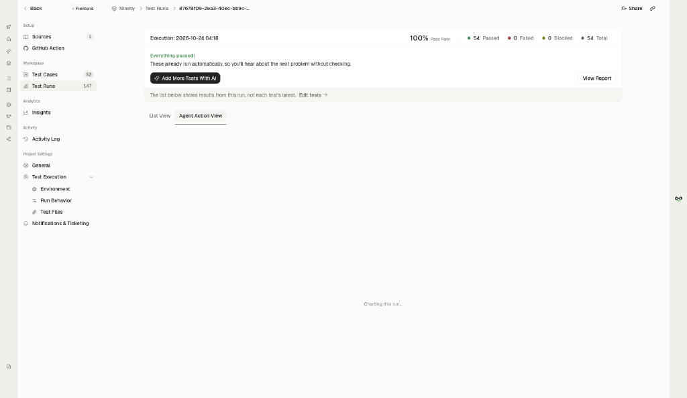
  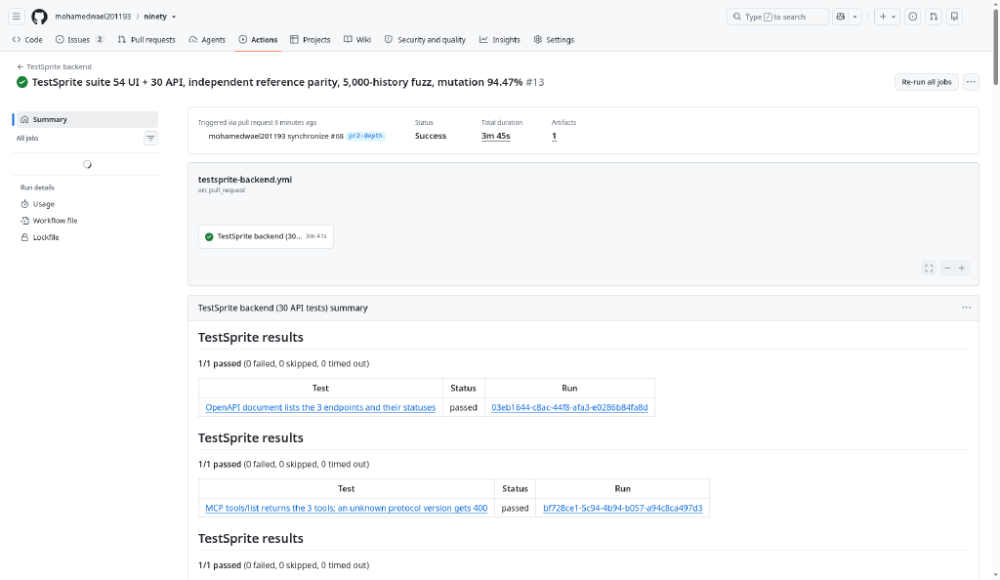
</p>
<p align="center">
  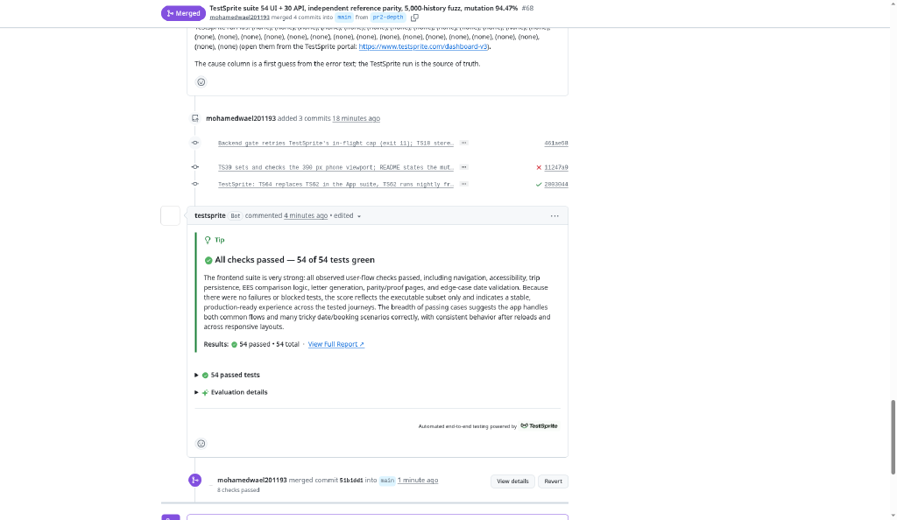
</p>

Every pull request must pass **seven required checks** before it can merge into `main` (branch protection, enforced for admins, and changes reach `main` only through a pull request). The two TestSprite suites, and the gate that reads both:

| Gate | What runs | Where |
|---|---|---|
| `TestSprite V3` | **54** TestSprite cloud end-to-end tests ([`test-ids.json`](testsprite_tests/test-ids.json), plans in [`testsprite_tests/plans`](testsprite_tests/plans)) through the TestSprite GitHub App | the PR's Vercel preview |
| `TestSprite backend (30 API tests)` | **30** TestSprite backend tests ([`backend-ids.json`](testsprite_tests/backend-ids.json), code in [`testsprite_tests/backend`](testsprite_tests/backend)) through the CLI in [`testsprite-backend.yml`](.github/workflows/testsprite-backend.yml) | the PR's Vercel preview, and production after each push to `main` |
| `TestSprite N/N gate` | Reads the newest `TestSprite V3` status by `testsprite[bot]` (`All 54 tests passed` / `42/43 passed · 1 failed`) and this run's backend results on the same head SHA; fails unless both are N/N with N > 0, and fails closed on a missing or unreadable result ([`nn-gate.mjs`](scripts/ci/nn-gate.mjs), [`docs/NN-GATE.md`](docs/NN-GATE.md)) | the PR head SHA |

**What we checked before building it:** on this repo `TestSprite V3` is a commit status, not a check run, and the count is only in its description. As of #70, across all 99 final statuses on 60 PRs it never said `success` with a failed or blocked test: 70 `success` (`All N tests passed`), 27 `failure` (`x/N passed · …`), 2 `failure` (`could not start`) ([raw list](docs/evidence/nn-gate/testsprite-v3-final-statuses.txt)). The gate makes that a rule instead of an observation, and ties both suites to one commit.

PR #70 (merged as [`d787b01`](https://github.com/mohamedwael201193/ninety/commit/d787b01a438bb46e7094a5b38f0128fe4a3cb842), 2026-10-25): its last commit `c62fdd5` passed **54/54** ("All 54 tests passed") and **30/30** on the backend gate ([run](https://github.com/mohamedwael201193/ninety/actions/runs/40149772752)), and the N/N gate passed ([checks](https://github.com/mohamedwael201193/ninety/pull/70/checks)). PR #68 (merged as `51b1dd1`, 2026-10-24 01:22 UTC): last commit `2803044` passed **54/54** ("All 54 tests passed") and **30/30** on the backend gate ([run](https://github.com/mohamedwael201193/ninety/actions/runs/40049174467)). Its two earlier commits were red: `db7776c` (`52/54 passed · 1 failed · 1 blocked`: TS18's healed code had an older preview URL hardcoded; TS62 blocked) and `11247a9` (same count: TS42 read a blank "Days used", TS62 blocked because the App's browser cannot be set to phone width). Fixed in the tests, not the app; details in [`docs/evidence/suite-54-30/`](docs/evidence/suite-54-30/README.md). PR #69's first commit `73013f6` ran 52/54: TS39 failed because the App cannot set phone width (moved to the CLI-only project, replaced by TS65), and TS42 again read "Days used" as blank; TS42 now reads the Latest legal exit tile, a plain date that moves from 2024-11-23 on day 180 to 2024-11-24 on day 181, instead of the small count next to the ring's rolling digits. Before that, #62 passed 43/43 and #63 merged over one TS42 flake (42/43), listed in [`LOOP.md`](LOOP.md).

**Added on 2026-10-24: 12 frontend tests (TS53–TS61, TS63, TS64, TS65) and 2 backend tests (BE29, BE30)** for flows nothing covered before: the developers page and its OpenAPI document, impossible `?today=` dates on `/` and `/ees`, cancelling the trip sheet, deleting every trip, the deep parity score on `/parity`, the skip link, footer links, the 180-day window bar dates, the landing band after saving trips, saved trips carried to the EES comparison (TS64), the 12 hand-worked boundary cases on `/parity` (TS65), `/api/v1/ees-reconcile` and `/api/v1/letter`. Each was run locally, then run with one expected value changed to prove it can fail, then run on TestSprite: 11/11 and 2/2 passed. TS39 and TS62 moved to the CLI-only phone project (above). Run ids and the mutation used for each: [`docs/evidence/suite-54-30/`](docs/evidence/suite-54-30/README.md).

<p align="center">
  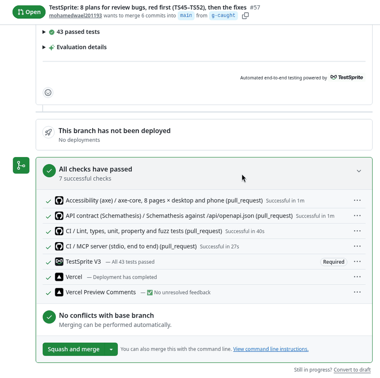
  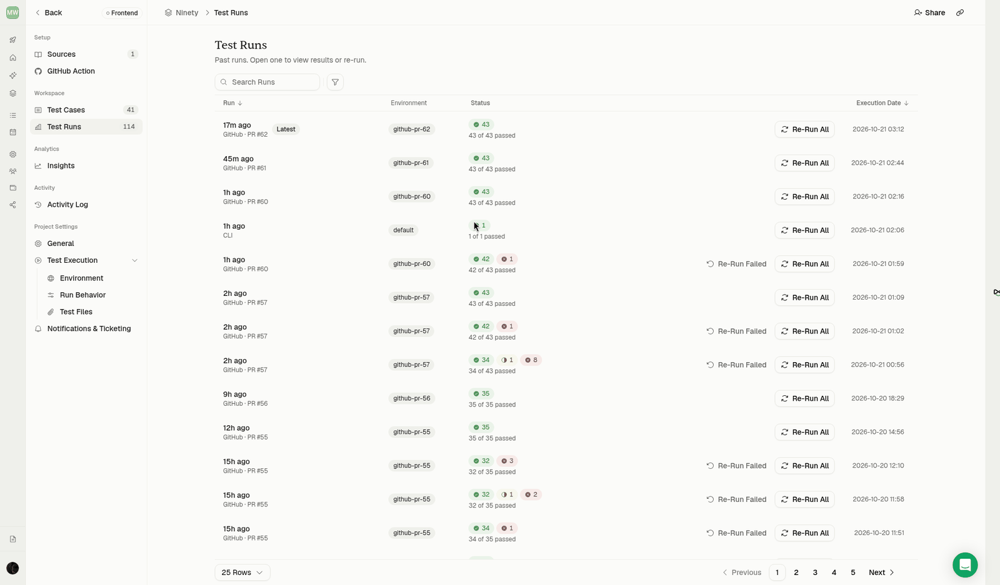
</p>

The expected values come from the European Commission's calculator or from the regulation and the specs, never from Ninety's own output. Around them, on every PR: 408 Vitest unit, property and fuzz tests, 5,000 random histories against the Commission script, 1,200 generated cases against an independent reference of the rule, an OpenAPI contract test (Schemathesis), axe-core on 8 pages × desktop and phone, and an end-to-end test of the stdio MCP server.

## What TestSprite caught

Screenshots of the PR #57 red-then-green runs, the merge gate and the portal, with captions: [`docs/evidence/testsprite/`](docs/evidence/testsprite/README.md).

Counted from the `TestSprite V3` commit statuses of every merged pull request (raw list: [`src/data/loop-iterations.json`](src/data/loop-iterations.json), regenerated through #70 by `scripts/loop-iterations.mjs`; why each red run happened: [`testsprite_tests/red-runs.json`](testsprite_tests/red-runs.json). The older [`pr-testsprite-history.json`](docs/evidence/receipts/pr-testsprite-history.json) stops at PR #56 and is kept as a snapshot).

The whole loop, iteration by iteration: [`LOOP-ITERATIONS.md`](LOOP-ITERATIONS.md) numbers the 64 merged pull requests (through #70) in merge order. Each iteration links the PR, the merge commit, every commit's `TestSprite V3` status and the TestSprite execution behind it. 14 iterations went red, then green (6 app defects, 1 UX loading state, 7 test plan or CI); the 2 runs that could not start or were blocked are listed apart. It is generated from the GitHub API and TestSprite's run history by [`scripts/loop-iterations.mjs`](scripts/loop-iterations.mjs) and checked by [`iterations.test.ts`](src/lib/loop/iterations.test.ts).

The other four required checks (seven in all): `Lint, types, unit, property and fuzz tests` and `MCP server (stdio, end to end)` ([`ci.yml`](.github/workflows/ci.yml)), `Schemathesis against /api/openapi.json` ([`api-contract.yml`](.github/workflows/api-contract.yml)) and `axe-core, 8 pages × desktop and phone` ([`a11y.yml`](.github/workflows/a11y.yml)). A change to Markdown or `docs/` only passes the backend gate without a paid run (the job lists the PR's files first); anything else runs all 30 tests.

**Triage on red.** If the backend gate fails on a PR, the same job posts a comment on the PR: each failing test, a first-guess cause from TestSprite's error line, the TestSprite run id, a link to the test code and the command to rerun only those tests ([`triage.mjs`](scripts/ci/triage.mjs)).

**Nightly smoke.** [`testsprite-smoke.yml`](.github/workflows/testsprite-smoke.yml) runs 5 TestSprite tests (TS01, TS03, TS07, TS62, TS39) against production every night with the CLI, 2.5 credits a run instead of 27 for the whole suite of 54. TS62 (the phone days bar) and TS39 (every page reachable from the phone navigation) check 390 px. The GitHub App runs tests in a desktop-size browser it cannot resize (TS62 was blocked on #68, TS39 failed on #69 with "viewport resizing was unavailable"), so both live in a separate CLI-only project, "Ninety phone width (CLI only)" ([`phone-ids.json`](testsprite_tests/phone-ids.json)), whose CLI replay honours the 390 x 844 viewport, and are not among the 54. Their places in the App suite went to TS64 and TS65, desktop flows nothing tested before. It makes one `testsprite test run <id> --target-url … --wait` call per test ([`smoke-run.mjs`](scripts/ci/smoke-run.mjs)): CLI 0.15.0 refuses several ids in one call against a URL ("several test ids run through one tunnel with --local <port>"). Each run is recorded on the Run log issue by [`run-ledger.yml`](.github/workflows/run-ledger.yml); a red night opens a `testsprite-red` issue with the failing tests, and failure bundles (`testsprite test artifact get`) are uploaded with the run. Its first run went red: TS03 was blocked as `stale_code` (stored script older than its plan), the ledger opened #66, and the rewritten script passed on TestSprite ([evidence](docs/evidence/ts03-stale-code/README.md)).

<p align="center">
  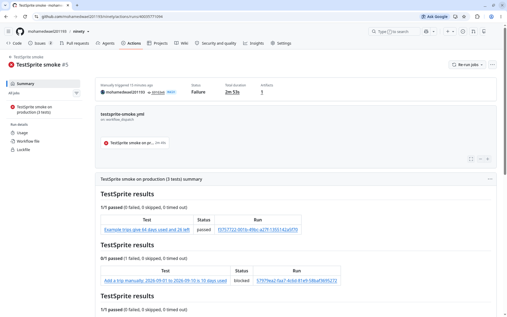
  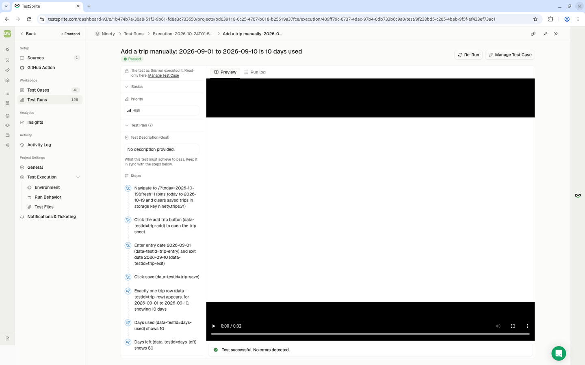
  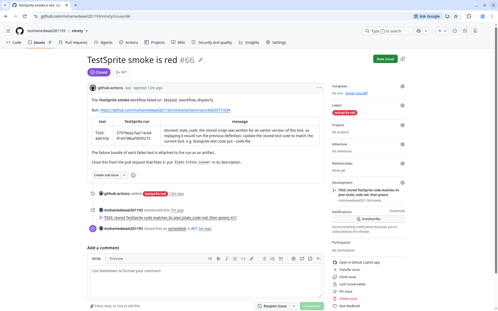
  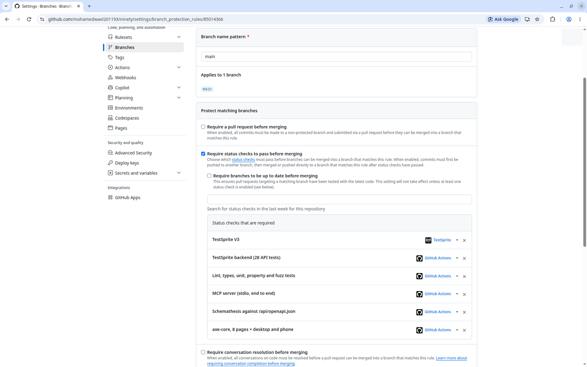
</p>

All eight screenshots with captions: [`docs/evidence/pr65-67/`](docs/evidence/pr65-67/README.md).

**7 real app bugs in 6 pull requests** (#41 caught two, one row), each red on the PR preview and fixed in the same PR. The status strings are copied from GitHub:

| PR | Red status | What was wrong |
|---|---|---|
| #8 | `9/11 passed · 2 failed` (PR head [46336bf](https://github.com/mohamedwael201193/ninety/commit/46336bfb0d7e6a4ea622f0125f66391be9783a93)) | The parity table's row loop started at index 1 and dropped the first scenario |
| #14 | `12/14 passed · 2 failed` | The planner ignored the days of an open stay before a planned trip |
| #39 | `14/15 passed · 1 failed` | A demo scenario was lost on the way to `/ees` and `/letter` |
| #41 | `14/15 passed · 1 failed`, then `16/17 passed · 1 failed` | Reloading a `?fresh=1` page wiped saved trips again; the evidence table's difference cell read as blank |
| #55 | `34/35 passed · 1 failed` | Closing the trip sheet with Escape left keyboard focus on the page body instead of "Add trip" |
| #57 | `42/43 passed · 1 failed` (PR head [dae0081](https://github.com/mohamedwael201193/ninety/commit/dae00815749666ebcdce147abd640bb47e260eac); blocked on PR head [78ee487](https://github.com/mohamedwael201193/ninety/commit/78ee487ff8e33740cbec59465e7ca97237787757); merged as `396d6d9`) | `/parity` said "couldn't verify": from Vercel's servers the Commission page did not come back as the calculator. Production showed the same. Fixed at PR head [1963cc1](https://github.com/mohamedwael201193/ninety/commit/1963cc1923403756491778893cea9e960dd2c32b): the stored, hash-checked copy is used, and the page says so |

**One UX loading state, not a wrong number:**

| PR | Red status | What was wrong |
|---|---|---|
| #60 | `42/43 passed · 1 failed` (PR head [1abce4c](https://github.com/mohamedwael201193/ninety/commit/1abce4c), fixed at [9a0c897](https://github.com/mohamedwael201193/ninety/commit/9a0c897), merged as `9f781f6`) | TS42 read "Days used" as empty: until the saved trips loaded, the count area was a blank skeleton, and the server HTML said only "Loading…" (about 3 s with the CPU slowed 20x; a wrong number was never shown). The tiles now say "Counting your saved trips…". The same test alone passed on production first, so this was intermittent ([note](LOOP.md#notes)) |

**Red on purpose, then green: 8 review bugs on #57.** TS45–TS52 were pushed with the code-review bugs they target still in place. The first run was `34/43 passed · 8 failed · 1 blocked`, and all 8 new tests failed on their bug. After the fixes the run was `All 43 tests passed`. TestSprite did not find these 8 first: they were found by independent Cursor review and reproduced by us. This PR shows the suite catches them. Screenshots: [`docs/evidence/testsprite/`](docs/evidence/testsprite/README.md).

**Went red, but the app wasn't the defect:** #18 and #22 (dependency and CI pull requests, `13/14 passed · 1 failed`, green on the re-run after merging `main`), #32 (`15/17 passed · 2 failed`, a plan step a cloud agent read differently), #36 (`13/14 passed · 1 failed`, TS26 had a wrong expected value) and #43 (`16/17 passed · 1 failed`, TS18 wording) and #68 (`52/54 passed · 1 failed · 1 blocked` twice: TS18 healed code with a stale URL, then TS42 an agent read; both stored scripts rewritten). The plan was fixed, not the app. Outside PR checks, the nightly smoke went red once (TS03 `stale_code`, issue [#66](https://github.com/mohamedwael201193/ninety/issues/66)) and went green after the fix ([evidence](docs/evidence/ts03-stale-code/README.md)); TS39 never went red, but its old script did not set a phone viewport and was rewritten. #9 (the run could not start) and #44 (blocked by the preview) are not counted.

**Found by an independent code review, reproduced by us.** Three rounds of a read-only Cursor review of this code reported bugs; we reproduced 26 of them (4, 6 and 16; one more in round 3 had already been fixed by round 2). Each was reproduced with a failing test first ([`review-findings.test.ts`](src/lib/bughunt/review-findings.test.ts), [`review-round2.test.ts`](src/lib/bughunt/review-round2.test.ts), [`review-round3.test.ts`](src/lib/bughunt/review-round3.test.ts)) and then fixed (related bugs share a row, so 26 bugs fill 16 rows):

| Bug | Reproduction | Fix |
|---|---|---|
| The latest legal exit and the planned-trip check ignored booked stays after the date | 2026-07-01 → 09-28 booked (90 days); on 2026-01-15 a 1-day plan on 06-01 said "fits", though the 180 days ending 09-28 would hold 91; the status line gave 2026-04-14 instead of 04-01 | Every 180-day window that a new day falls in is checked, later ones too; a brute-force test compares the allowance |
| Two trips with the same entry date: the first row won | Trips 06-01 → 06-10 and 06-01 → 06-20, EES 06-01 → 06-15, on 06-25: "likely missing entry" citing 06-10 | The comparison uses the latest exit (also for a missing exit) |
| The Article 52 letter threw when only the 10 April 2026 cutoff explained the gap | `POST /api/v1/letter` and the MCP tool raised "No correction to request…" | `422` naming 2026-04-10; the MCP tool returns `isError: true` |
| The 64 KB body limit counted characters, not bytes | 40,000 × "é" (80 KB) got through on REST and `/api/mcp` | The limit is checked on the body's bytes |
| `/proof` still listed 36 parity ids from a dropped scenario set and a test file that no longer existed | `src/data/proof.json` had not been regenerated after `rules.json` went back to the 14 scenarios; the unit test only read `rules.json` | `proof.json` rebuilt from `rules.json`; a test now fails if they differ |
| An open stay with an earlier EES exit was called a missing entry | Open trip from 2026-06-01, EES 06-01 → 06-10, on 06-20 | An open stay ends on the reference date for the exit comparison: "exit dates disagree" |
| The letter page drafted a rectification request when the figures matched | Trips 06-01 → 06-10, EES figure 10 | No letter: "the EES figure matches your trips" |
| `/api/mcp` accepted any `MCP-Protocol-Version` and answered a request with `id: null` | `1999-01-01` → 200; `id: null` → a result | `400` for an unsupported version; `-32600` for a null id (MCP 2025-06-18) |
| The OpenAPI identity fields lacked the limits the API enforces | nationality of 61 characters: 400 from the API, allowed by the document | `maxLength` 60 / 60 / 200 in the document |
| One stay entered as two rows (France, then Germany) gave a false "exit dates disagree" and a letter | Trips 06-01 → 06-10 and 06-10 → 06-20, one EES record 06-01 → 06-20 | Trips that continue on the same or the next day are one stay for the EES comparison: `match`, no letter |
| A name the PDF font cannot draw (Chinese, emoji) became invisible characters | `李明` gave `\u0000\u0000` in the PDF | The download is refused with the characters named; the letter text can still be copied |
| `packages/ninety-mcp` `npm test` failed on Node 22, which CI uses | `node --test test/` is read as a module path | `node --test test/*.test.mjs` |
| The letter page drafted a letter while the comparison had input errors; line breaks and bidi controls in identity fields could forge letter paragraphs | `fullName: "Jane\n\nYours faithfully,\n\nMallory"` | No letter on input errors; one-line text only (400 naming the field) |
| The OpenAPI document allowed dates and blank names the API refuses; the API's email rule differed from the form's | `on: "1899-12-31"`, `fullName: " "`, `jürgen@münchen.de` | Date range and non-blank text in the document; one email rule |
| The stdio MCP server answered an unknown tool as a tool result; the PDF Author held the identity paragraph; the planned-trip bar ignored an open stay; a later overstay was called "earlier" | | `-32602`; Author is the signer; the bar counts what the verdict assumes; "later" |
| Protocol details on `/api/mcp` and the REST routes | a batch under MCP 2025-06-18, `initialize` in a batch, `params: "nope"`, `Content-Type: Application/JSON`, `GET` without `Allow` | Refused or answered per the MCP and JSON-RPC specs and RFC 9110 |


## The loop log

[`LOOP-ITERATIONS.md`](LOOP-ITERATIONS.md) numbers all 64 merged pull requests (through #70) in merge order, each with its merge commit, every commit's `TestSprite V3` status and the execution behind it. [`LOOP.md`](LOOP.md) tells the same story as a narrative. Both are generated from the GitHub API and TestSprite's run history ([`scripts/loop-iterations.mjs`](scripts/loop-iterations.mjs), [`scripts/loop-proof.mjs`](scripts/loop-proof.mjs)); [`iterations.test.ts`](src/lib/loop/iterations.test.ts) fails if this README, `LOOP.md` and the JSON disagree. `/proof` shows the same data per rule.

## Parity with the European Commission calculator

- **14/14** fixed scenarios (the Commission manual's worked examples and edge cases) match the Commission's own calculator script, down to the latest legal day ([`/parity`](https://ninety-coral.vercel.app/parity), [`parity.test.ts`](src/lib/schengen/parity.test.ts)). The page shows the result from a stored, SHA-256-checked copy of the official script immediately and replaces it only if the live Commission page loads; the label says which copy you are looking at.
- **399/400** of 400 stored inputs the Commission form accepts match on every printed field; 12 more that the form refuses are listed with both answers, 412 in all ([`deep.test.ts`](src/lib/schengen/deep/deep.test.ts)). The one difference, explained: [`docs/PARITY-399.md`](docs/PARITY-399.md).
- **12** hand-worked boundary cases ([`golden.ts`](src/lib/schengen/golden.ts)) and **5,000** random histories per PR / **20,000** per night against the Commission script ([`differential.fuzz.test.ts`](src/lib/schengen/differential.fuzz.test.ts); reproduce: `FUZZ_RUNS=5000 FUZZ_SEED=20261019 npx vitest run src/lib/schengen/differential.fuzz.test.ts`).
- **1,200** generated cases per PR / **20,000** per night against an independent reference of the rule ([`reference-rule.ts`](src/lib/schengen/reference-rule.ts)), written from Regulation (EU) 2016/399 Art. 6(1) and the Commission manual with its own date arithmetic and no code shared with the engine. Half are random; half sit on a boundary: day 180 and 181 after a stay day, 29 February 2024 and 2028, the year change, the 2026 clock changes. All agree on days used, presence, overstay, days left and latest exit; 9 named cases worked by hand (leap day on day 180 and 181, day 180/181, both 2026 clock changes, the year boundary, exactly 90 and day 91) give the same numbers in both ([`reference-rule.test.ts`](src/lib/schengen/reference-rule.test.ts); reproduce: `REF_CASES=1200 REF_SEED=20261024 npx vitest run src/lib/schengen/reference-rule.test.ts`). Scope: histories with no stay after the date asked about.
- **Mutation score 94.47% (combined)** on the engine (`engine.ts` and `dates.ts`, StrykerJS, `npm run mutation`): 376 of 398 mutants killed (360) or timed out (16), 18 survived, 4 without coverage. Combined means: one full run gave **87.44%**; the surviving mutants pointed at untested behaviour (anchored date formats, error messages, invalid plan dates, a next legal entry exactly 180 days ahead), now pinned in [`mutation-gaps.test.ts`](src/lib/schengen/mutation-gaps.test.ts); then only the lines that had survivors or no coverage were re-run, and their new results replace the old ones. No single clean full run at 94.47% has been made yet. Every mutant, both runs and the 22 left: [`docs/evidence/mutation/summary.json`](docs/evidence/mutation/summary.json). Most of the 18 left are equivalent (a sort tie-break, `> 0` vs `>= 0` on an overlap, loop bounds past the 120-day horizon). A full run takes about an hour, so it is not in CI.

Details: [Parity with the European Commission calculator](#parity-with-the-european-commission-calculator--1414-parity).

## API and MCP

| Endpoint | MCP tool | Answers |
|---|---|---|
| `POST /api/v1/check` | `schengen_check` | days used and left, latest legal exit, next legal entry, overstays, whether a planned trip fits |
| `POST /api/v1/ees-reconcile` | `ees_reconcile` | the EES figure against your trips: gap, likely cause, differing days |
| `POST /api/v1/letter` | `article52_letter` | the Article 52 request |

No key, open CORS, nothing stored. [OpenAPI 3.1](https://ninety-coral.vercel.app/api/openapi.json); MCP over streamable HTTP at `/api/mcp` and as a stdio server in [`packages/ninety-mcp`](packages/ninety-mcp). Examples on [`/developers`](https://ninety-coral.vercel.app/developers); details [below](#public-api-and-mcp-server-developers).

```bash
curl -s -X POST https://ninety-coral.vercel.app/api/v1/check -H 'content-type: application/json' \
  -d '{"trips":[{"entry":"2026-05-01","exit":"2026-06-15"},{"entry":"2026-08-20","exit":"2026-09-30"}],"on":"2026-10-19"}'
# {"on":"2026-10-19","daysUsed":88,"daysLeft":2,...}
```

## Architecture

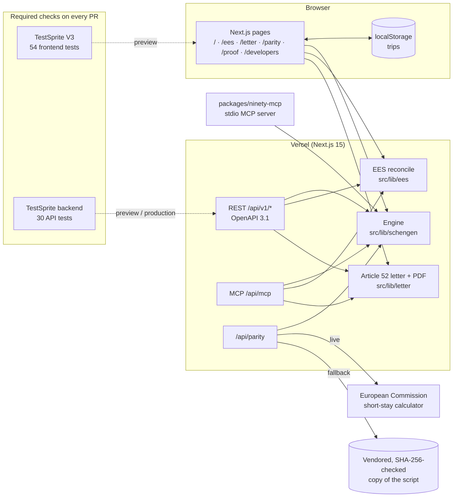

## Running locally

Node 22 (as in CI).

```bash
npm ci
npm run dev          # http://localhost:3000
npm test             # Vitest: 408 passing, 3 skipped (they need the live Commission page)
npm run lint && npm run typecheck && npm run build
```

`npm run a11y` runs axe-core, `npm run proof:matrix` rebuilds `/proof` data, `node scripts/loop-iterations.mjs` rebuilds the loop log (needs a GitHub token). The stdio MCP server: `cd packages/ninety-mcp && npm test`.

## Evidence index

Receipts, each checkable in this repo; TestSprite figures as of the #70 merge (`d787b01`), times in UTC. The full index of screenshots and runs is [`docs/evidence/EVIDENCE_INDEX.md`](docs/evidence/EVIDENCE_INDEX.md).

| | |
|---|---|
| **14/14** | scenarios on [`/parity`](https://ninety-coral.vercel.app/parity) match the European Commission's own calculator (the manual's worked examples and edge cases), compared down to the latest legal day, from a stored, hashed copy on every PR ([`parity.test.ts`](src/lib/schengen/parity.test.ts)) and against the live page every night ([`drift.yml`](.github/workflows/drift.yml), last nightly [green](https://github.com/mohamedwael201193/ninety/actions/runs/39366383632), 2026-10-20 03:50 UTC; a manual re-run on `main` at 22:54 UTC [failed](https://github.com/mohamedwael201193/ninety/actions/runs/39511457009) because the Commission page answered "Server temporarily unavailable", so the live check could not run. `/parity` then uses the stored copy, as described below) |
| **399/400** | stored scenarios the Commission form accepts match its vendored script on every printed field; 12 more the form refuses are listed with both answers, 412 in all ([`deep.test.ts`](src/lib/schengen/deep/deep.test.ts) re-runs the script) |
| **12** | hand-worked boundary cases, each a different situation, whose answers were written down first and then checked word for word against what the calculator prints ([`golden.ts`](src/lib/schengen/golden.ts)) |
| **5,000 / 20,000** | random travel histories through Ninety and the Commission calculator per PR / per night (500 / 3,000 until 2026-10-24) (overlaps, open stays, trips out of order, exit before entry, dates around 10 April 2026 and the spring clock change), 0 disagreements after the one bug it found was fixed ([`differential.fuzz.test.ts`](src/lib/schengen/differential.fuzz.test.ts), [`ci.yml`](.github/workflows/ci.yml), last nightly [green](https://github.com/mohamedwael201193/ninety/actions/runs/39359668818); a manual re-run on `main` at 2026-10-20 22:54 UTC, 500 histories, also [green](https://github.com/mohamedwael201193/ninety/actions/runs/39511460593)) |
| **Properties** | checked against brute force on random histories: no legal answer ever has more than 90 days in a 180-day window, a planned trip "fits" exactly when every window stays at 90 or less, and the output is deterministic and independent of trip order ([`properties.test.ts`](src/lib/schengen/properties.test.ts), [`properties.legal.test.ts`](src/lib/schengen/properties.legal.test.ts)) |
| **54** | TestSprite cloud tests on every PR preview (TS45–TS52 added for bugs found in code review, TS53–TS61, TS63, TS64 added on 2026-10-24), `TestSprite V3` a required check ([`test-ids.json`](testsprite_tests/test-ids.json), plans in [`testsprite_tests/plans`](testsprite_tests/plans)) |
| **30** | TestSprite backend tests (REST, MCP, parity API) on every PR preview and on production after each push to `main`, `TestSprite backend (30 API tests)` a required check ([`testsprite-backend.yml`](.github/workflows/testsprite-backend.yml)) |
| **54/54** | passed on PR #70 ([checks](https://github.com/mohamedwael201193/ninety/pull/70/checks), merged as `d787b01`), with 30/30 on the backend gate and the N/N gate green; also on PR #68 (merged as `51b1dd1`). Earlier: 43/43 on PR #62 (PR head [a5f6bde](https://github.com/mohamedwael201193/ninety/commit/a5f6bde), merged to `main` as `a777c3b`; status "All 43 tests passed", 2026-10-21 00:12 UTC; [execution](https://www.testsprite.com/dashboard-v3/o/1b474b7a-30a8-51f3-9b61-fd8a3c733650/projects/bd039118-0c25-4707-b018-b25619a37fce/execution/b43fc678-1b47-4f4f-9c4c-cd08eb76daac)). Also 43/43 on #61 ([execution](https://www.testsprite.com/dashboard-v3/o/1b474b7a-30a8-51f3-9b61-fd8a3c733650/projects/bd039118-0c25-4707-b018-b25619a37fce/execution/d5ce97c4-05b4-4d90-b30f-7b62d893514a)) and #60; 43/43 on PR #57 ([screenshots](docs/evidence/testsprite/README.md)) and 35/35 on PR #56 ([portal report PDF](docs/evidence/portal-2026-10-20/testsprite-report-35of35-2026-10-20.pdf)). PR #63 ran 42/43: one TS42 agent-read flake, passed 9/9 when rerun alone ([evidence](docs/evidence/ts42-isolated-rerun/)) |
| **7 + 1 + 8** | **7** real app bugs (wrong behaviour) that TestSprite found first on a PR preview, in 6 PRs. All 7 were fixed before merging, and one of them, TS02 on #57, also failed on production. **1** blank loading state (UX, not a wrong number), TS42 on #60. **8** bugs from code review that TestSprite failed red, then passed after the fix, on #57 ([What TestSprite caught](#what-testsprite-caught)) |
| **408** | Vitest unit, property and fuzz tests on every PR, all passing (3 more run only against the live Commission page) (`npm test`) |
| **3** | public API endpoints with an [OpenAPI 3.1 document](https://ninety-coral.vercel.app/api/openapi.json) (copy in [`docs/openapi.json`](docs/openapi.json), kept equal by a test), and the same three as MCP tools: over streamable HTTP at `/api/mcp` and as a stdio [server](packages/ninety-mcp), both tested with the official MCP client |
| **64** | pull requests merged into `main` as of the #70 merge |

---

## Details

### The 90/180 rule

A non-EU traveller may stay in the Schengen area for **at most 90 days in any rolling 180-day period**. On any date you look back 180 days (that day included) and count every day you were present. Entry day and exit day both count.

Ninety rebuilds that count from the trips you enter and tells you:

- days used and days left on any date,
- the latest legal exit for a stay in progress,
- whether a **planned trip** fits, and if not, how many days it overruns,
- exactly when and by how much a past stay went over 90.

Trips are typed as `YYYY-MM-DD` (other formats such as `MM/DD/YYYY` are rejected with a clear message), overlapping trips are flagged, and everything is stored only in your browser — no account, no server.

### Scenario links

Any named demo history opens with one link, without touching your saved trips (edits to a demo are not saved):

| Link | History | Read on |
|---|---|---|
| `/?scenario=open-stay` | In the Schengen area since 2026-10-01, no exit yet | 2026-10-19 |
| `/?scenario=near-limit` | 2026-05-01 → 06-15 and 2026-08-20 → 09-30: 88 of 90 days used | 2026-10-19 |
| `/?scenario=overstay` | 2026-06-01 → 09-15: a 107-day stay | 2026-10-19 |

`?today=YYYY-MM-DD` still overrides the date. The scenarios live in `src/lib/scenarios.ts`, with tests.

### EES reconciliation (`/ees`)

The Entry/Exit System now records every crossing and shows a days-used figure. When an exit is not recorded, that figure can be badly wrong — and it is the border's number, not yours, that decides whether you are let in.

Enter the EES figure (and, if you have them, the EES entry/exit records — plain `ENTRY EXIT` lines or `Entry …` / `Exit …` lines). Ninety:

- shows both counts side by side and the gap between them,
- names the likely cause (missing exit, missing entry, exit dates that disagree, or an EES figure that contradicts its own records),
- lists the exact days that differ, grouped into ranges.

### The Article 52 letter (`/letter`)

Article 52 of Regulation (EU) 2017/2226 lets you ask the competent authority of any Member State to rectify, complete or erase your EES data. Ninety drafts that request in your own words — first person, with your details, the two counts and the exact differing days — and cites the reply deadlines in Article 52(1)–(4). Copy it or download it as a PDF (accented names included), then review, sign and send it yourself.

### Parity with the European Commission calculator — 14/14 (`/parity`)

A day-count tool is only useful if it gives the official answer. `/parity` runs 14 fixed scenarios through both the European Commission's own short-stay calculator script and Ninety's engine (the result from the stored, hashed copy is shown at once; the server then tries the live page and replaces it only if that loads), and shows each one: Ninety's count, the calculator's count, whether they match, and, for a stay, the latest legal day each one gives (`data-testid=parity-span-ours` / `parity-span-theirs`). The scenarios are the Commission manual's worked examples plus edge cases: exactly 90 days, day 91, re-entry after a full 90, same-day stays and turnarounds, and a date just after a clock change. From Vercel's servers the live Commission page currently does not come back as the calculator, so production shows **14/14 from the stored, SHA-256-checked official copy, with a notice saying so** (the live error, the hash and the fetch date). Only the wider live sample says "couldn't verify", because it needs the live page. If neither the live page nor an intact stored copy is available, the 14 scenarios say "couldn't verify" too, never a match.

A wider set is checked against the same vendored script, field by field (days left, the 90- and 180-day period starts, possible stay until, a last legal day with 0 left, a refused entry, the next date a stay is allowed, each overstay window, the length of each stay, and a refusal when the exit is before the entry). 399/400 of the inputs the calculator accepts match on every one of those fields. The other one is an overlap the calculator lists as two overstays (6 days inside 11) where Ninety lists the 11 days once; the calculator itself prints one 11-day overstay when the same days are entered as one stay ([`docs/PARITY-399.md`](docs/PARITY-399.md)). The calculator's raw output is in [`oracle-output.json`](src/lib/schengen/deep/oracle-output.json); [`deep.test.ts`](src/lib/schengen/deep/deep.test.ts) re-runs the script and fails if that file differs. `/parity` shows the count and every case that does not match.

The vendored calculator page ([`commission-calculator.ts`](src/lib/schengen/vendor/commission-calculator.ts)) is © European Union, the European Commission's short-stay calculator, reused unmodified with acknowledgement of the source under Commission Decision 2011/833/EU. Ninety is not affiliated with the Commission.

Below it, **12 hand-worked cases**, each a different situation (a test fails if two share the same reasoning): overlapping trips, an open stay through today, refused entry until the first day leaves the window, the spring clock change, leap day on the last day of the window and the day after, exit before entry, old days leaving during a stay, consecutive exit and entry days, a stay across the EES cutoff, two stays that add up to 93, and overlapping trips that overstay. Each one's answer was written down first with how it was reached (`why` in [`golden.ts`](src/lib/schengen/golden.ts)); the test checks that Ninety gives it and that the calculator prints the exact sentences listed. Writing them down first caught one of our own mistakes: a planned "two old stays, 90 left" case actually added up to 93 days in one window, an overstay. It is kept as a case, with the wrong first answer recorded next to the right one.

What the calculator itself does, found while doing this: it needs an exit for every stay (an open stay is closed on the control date), refuses an exit before the entry or after the control date, and refuses overlapping stays, except that it never compares the first stay with the second. The fuzzer gives it sorted, merged input for that reason.

The fuzzer also found a bug in Ninety: two overlapping trips that overstay were listed as two overstays (6 and 11 days) for 11 real days (seed 20261019, run 14). It is pinned as a named case and fixed: overlapping stays are merged before overstays are counted.

### Public API and MCP server (`/developers`)

The engine is also a JSON API on the same deployment, with no key and open CORS. Nothing you send is stored.

| Endpoint | Answers |
|---|---|
| `POST /api/v1/check` | days used and left on a date, latest legal exit, next legal entry, overstays, and (with `planned`) whether a trip fits |
| `POST /api/v1/ees-reconcile` | the EES figure against your trips: the gap, the likely cause, the exact days that differ |
| `POST /api/v1/letter` | the Article 52 request, drafted from your details and the comparison |

```bash
curl -s -X POST https://ninety-coral.vercel.app/api/v1/check -H 'content-type: application/json' \
  -d '{"trips":[{"entry":"2026-05-01","exit":"2026-06-15"},{"entry":"2026-08-20","exit":"2026-09-30"}],"on":"2026-10-19"}'
# {"on":"2026-10-19","daysUsed":88,"daysLeft":2,...}
```

A Schemathesis job ([`api-contract.yml`](.github/workflows/api-contract.yml)) generates requests from the OpenAPI document on every pull request and runs them against a production build: every answer must match the schema for its status, schema-valid requests must get 200 (or the documented 422), and nothing may be a server error. It is free and needs no secrets. Its coverage phase is off because it sends `TRACE`, which Next.js itself answers with a 500 before any app code runs.

Input is checked field by field (`400` names the path, for example `trips.0.entry`), dates that cannot be counted give `422`, and bodies are capped at 64 KB. The [OpenAPI 3.1 document](https://ninety-coral.vercel.app/api/openapi.json) is generated from the same file the tests read, and a test runs its example request and checks every documented field comes back. The examples on `/developers` are produced by the real functions when the page is built.

`POST /api/mcp` serves the same three tools over MCP streamable HTTP (stateless JSON-RPC: `initialize`, `tools/list`, `tools/call`, `ping`), from the same code; its unit test runs in `npm test`, and the official MCP client was run against it locally. [`packages/ninety-mcp`](packages/ninety-mcp) is a stdio MCP server with three tools, `schengen_check`, `ees_reconcile` and `article52_letter`, which call the same functions with the same input schemas. Its test starts the built server with the official MCP client, lists the tools and calls each one; CI runs it on every pull request.

### Scenario gallery

The home page has six worked histories (open stay, 88 of 90, overstay, same-day re-entry, a stay before the EES cutoff, and a mixed one). Each card's figures are computed by the engine at build time, opens its history with `?scenario=` without touching saved trips, and names the TestSprite tests that check that same history ("guarded by TS27"). A unit test fails if a card names a plan that does not exist.

### TestSprite backend tests (API and MCP)

A second TestSprite project, "Ninety API" (backend, `790eba05`), holds 30 Python tests against production. They cover:
- the three REST endpoints, `/api/mcp` and `/api/parity`, including an EES reconciliation with exit dates that disagree (BE29) and the Article 52 letter: drafted for a gap, refused on a match, missing identity fields named (BE30);
- leap days, the 90/91-day and 180/181-day edges, same-day re-entry and open stays;
- duplicates and 60 trips, the 200-trip and 64 KB limits, malformed JSON, Content-Type variants;
- the 1900–2199 date range, the UTC default date;
- JSON-RPC errors, notifications and batches, CORS, HEAD and 405.

Expected values come from the vendored Commission calculator (the outputs are recorded in each test's comment) or from the spec (Art. 6(1) Schengen Borders Code, OpenAPI, JSON-RPC 2.0, MCP 2025-06-18, RFC 9110), never from Ninety's own answers. One exception is recorded in BE14: with 60 one-day trips, the Commission script gives a figure that a day-by-day count of the rule does not support. The same trips minus the first 10 give the day-by-day answer, so BE14 uses the day-by-day count.

The GitHub App runs only the frontend project, so these tests run from the CLI (`testsprite test run --all --project 790eba05-abdb-41c5-ae1a-4b2b0131b438 --no-auto-heal`), at 0.2 credits each. Ids: [`backend-ids.json`](testsprite_tests/backend-ids.json).

**They are a merge gate too.** [`testsprite-backend.yml`](.github/workflows/testsprite-backend.yml) runs all 30 tests on every pull request, against that PR's Vercel preview once Vercel's commit status says it is ready, and on every push to `main`, against production after the deploy. The first version, merged in #61, waited for GitHub `deployment_status` events. This Vercel project never sends those, so it never ran; #62 switched to waiting on the commit status. Any failure fails the job. `TestSprite backend (30 API tests)` is a required status check on `main`, next to `TestSprite V3`. TestSprite gives backend tests no environment URL: `__VARS__` was empty even with a variable set, and the Starter plan allows one environment. So [`backend-run.mjs`](scripts/ci/backend-run.mjs) uploads the repository's copy of each test with its `BASE_URL` line pointing at the target, then runs it. Cost: 30 × 0.2 = **6.0 credits per run**: one per push to a PR, and one after each merge.

**Result, 2026-10-20 22:35 UTC: 27/28 passed ([portal run](https://www.testsprite.com/dashboard-v3/o/mohamed-waels-workspace-1b474b7a/projects/790eba05-abdb-41c5-ae1a-4b2b0131b438/execution/5071eab5-493e-4982-84fe-168a2133c981)). BE28 found a real bug.** `/api/mcp` answered a request whose `id` was not a string or a number (for example `true`) with an error that had no `id` member. JSON-RPC 2.0 section 5 requires `"id": null` there. The fix is in `src/lib/api/mcp-http.ts`, with `mcp-id.test.ts` (5 tests, red before the fix). Every other test passed on its first run, so they found no other bug. After the fix reached production (pushed to `main` as [`8c86d02`](https://github.com/mohamedwael201193/ninety/commit/8c86d02db93767e1a322fb99909a59b54f7426f9)), BE28 alone was re-run at 2026-10-20 22:38 UTC and passed ([portal run](https://www.testsprite.com/dashboard-v3/o/mohamed-waels-workspace-1b474b7a/projects/790eba05-abdb-41c5-ae1a-4b2b0131b438/execution/ef7bc14a-8d5c-467f-bc24-60ce3801ec2e)). Screenshots and the red/green files: [`docs/evidence/testsprite/`](docs/evidence/testsprite/README.md#backend-tests-ninety-api).

| Test | Checks |
|---|---|
| [`BE01-openapi-document`](testsprite_tests/backend/BE01-openapi-document.py) | OpenAPI document lists the 3 endpoints and their statuses |
| [`BE02-mcp-tools-list`](testsprite_tests/backend/BE02-mcp-tools-list.py) | MCP tools/list returns the 3 tools; an unknown protocol version gets 400 |
| [`BE03-check-overstay`](testsprite_tests/backend/BE03-check-overstay.py) | Check: 1 Jan to 15 Apr 2024 is 106 days, a 16-day overstay from 31 Mar |
| [`BE04-check-bad-input`](testsprite_tests/backend/BE04-check-bad-input.py) | Check: an impossible date, an unknown key and text/plain are refused |
| [`BE05-parity-14-of-14`](testsprite_tests/backend/BE05-parity-14-of-14.py) | Parity API: 14/14 match, from the live page or the named stored copy |
| [`BE06-leap-day-29-feb`](testsprite_tests/backend/BE06-leap-day-29-feb.py) | Leap year: 1 to 29 Feb 2024 is 29 days; Commission: 61 days left, stay until 2024-04-30 |
| [`BE07-leap-day-leaves-window`](testsprite_tests/backend/BE07-leap-day-leaves-window.py) | 29 Feb 2024 counts on 26 Aug 2024 (day 180) and is gone on 27 Aug |
| [`BE08-exactly-90-days`](testsprite_tests/backend/BE08-exactly-90-days.py) | Exactly 90 days: no overstay, 0 left, last legal day is the day itself |
| [`BE09-day-91-overstay`](testsprite_tests/backend/BE09-day-91-overstay.py) | Day 91 is a 1-day overstay on 31 Mar 2024 |
| [`BE10-window-edge-180-181`](testsprite_tests/backend/BE10-window-edge-180-181.py) | After 90 days: refused on day 180 after entry, next legal entry 29 Jun, 90 days on 29 Jun |
| [`BE11-same-day-reentry`](testsprite_tests/backend/BE11-same-day-reentry.py) | Same-day exit and re-entry counts the day once: 20 days, 70 left |
| [`BE12-open-stay`](testsprite_tests/backend/BE12-open-stay.py) | An open stay counts through the date: 10 days, 80 left, until 29 May |
| [`BE13-duplicate-and-overlap`](testsprite_tests/backend/BE13-duplicate-and-overlap.py) | Duplicate and overlapping trips count each day once |
| [`BE14-sixty-trips`](testsprite_tests/backend/BE14-sixty-trips.py) | 60 one-day trips, 3 days apart: 60 days used, 30 left |
| [`BE15-trip-limit-200`](testsprite_tests/backend/BE15-trip-limit-200.py) | 200 trips are accepted; 201 are refused with 400 (maxItems 200) |
| [`BE16-body-size-413`](testsprite_tests/backend/BE16-body-size-413.py) | Body limit is 64 KB of bytes: just under passes the size check, just over is 413 |
| [`BE17-malformed-json`](testsprite_tests/backend/BE17-malformed-json.py) | Malformed JSON bodies are a 400 JSON error, never a 500 |
| [`BE18-content-type-variants`](testsprite_tests/backend/BE18-content-type-variants.py) | Content-Type: application/json with charset and any case is accepted; others are 415 |
| [`BE19-date-range`](testsprite_tests/backend/BE19-date-range.py) | Dates 1900-2199 are counted (2100 is not a leap year); 1899 and 2200 are 400 |
| [`BE20-default-date-utc`](testsprite_tests/backend/BE20-default-date-utc.py) | Without 'on', the count is for today in UTC (spec) |
| [`BE21-exit-before-entry-422`](testsprite_tests/backend/BE21-exit-before-entry-422.py) | An exit before its entry is 422 (valid shape, cannot be counted) |
| [`BE22-planned-trip-boundary`](testsprite_tests/backend/BE22-planned-trip-boundary.py) | Planned trip: 61 days after 29 Feb fit, 62 do not (Commission: up to 61) |
| [`BE23-parity-vs-check`](testsprite_tests/backend/BE23-parity-vs-check.py) | Check agrees with the Commission figures that /api/parity reports |
| [`BE24-mcp-jsonrpc-errors`](testsprite_tests/backend/BE24-mcp-jsonrpc-errors.py) | MCP JSON-RPC errors: unknown method -32601, parse error -32700, invalid request -32600 |
| [`BE25-mcp-notification-batch-size`](testsprite_tests/backend/BE25-mcp-notification-batch-size.py) | MCP: a notification gets 202 with no body; a batch is refused; an oversized body is 413 |
| [`BE26-mcp-tool-call-oracle`](testsprite_tests/backend/BE26-mcp-tool-call-oracle.py) | MCP schengen_check on the Commission's 106-day example gives the 16-day overstay |
| [`BE27-cors-options-head`](testsprite_tests/backend/BE27-cors-options-head.py) | CORS preflight, HEAD and wrong methods follow HTTP |
| [`BE28-mcp-error-always-has-id`](testsprite_tests/backend/BE28-mcp-error-always-has-id.py) | MCP: an error for an invalid request id still carries "id": null (JSON-RPC 2.0 section 5) |
| [`BE29-ees-reconcile-exit-disagree`](testsprite_tests/backend/BE29-ees-reconcile-exit-disagree.py) | EES reconcile: 10 vs 14 days, `exit-dates-disagree`, the 4 EES-only days 11–14 Sep; a matching figure has no differences |
| [`BE30-letter-article52`](testsprite_tests/backend/BE30-letter-article52.py) | Article 52 letter: drafted to France with Art. 52(1)–(4) and the 45-day reply; 422 `no_difference` on a match; missing identity fields named |

### Proof (`/proof`)

`/proof` lists the 12 rules Ninety applies (90/180, entry and exit days, the rolling window, overstays, open stays, planned trips, input rules, EES findings, the 10 April 2026 cutoff, Article 52, parity) and, for each, the engine test, the Commission parity scenario and the TestSprite tests that guard it, with each test's latest cloud result. The table comes from `src/data/rules.json` and `npm run proof:matrix` (TestSprite reads only), and a unit test fails if any test it names stops existing.
