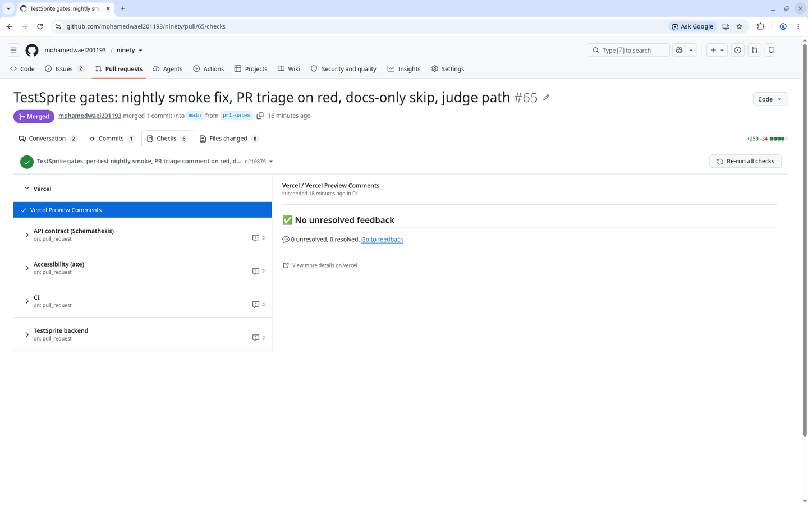
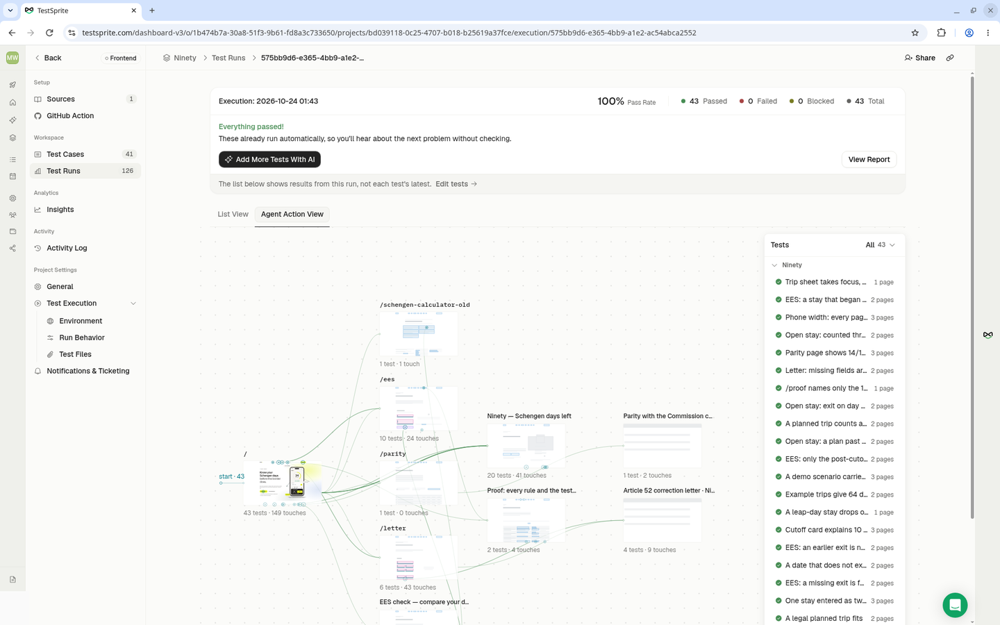
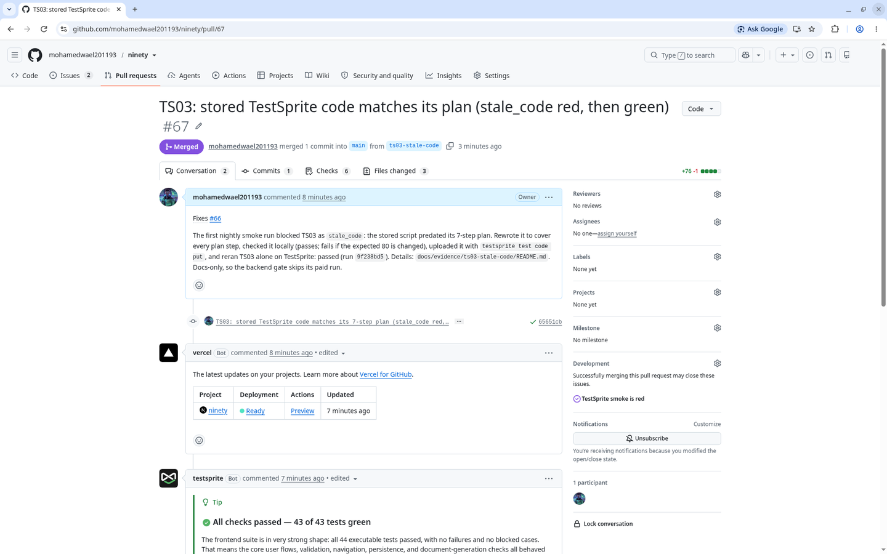
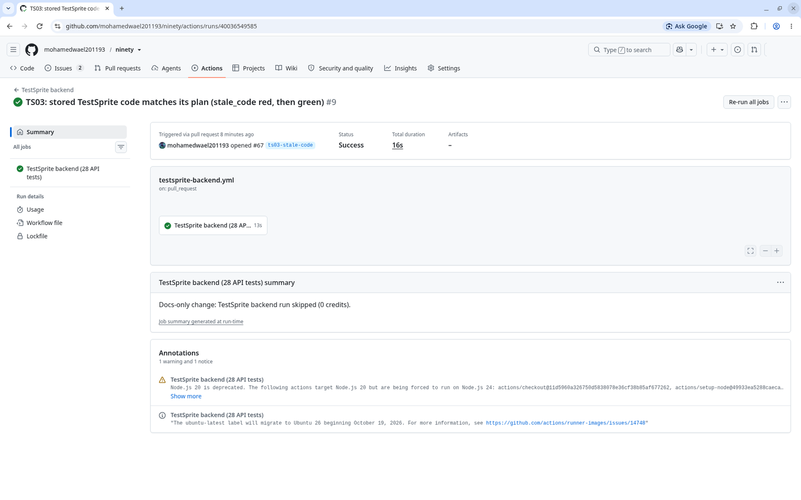

# PR #65 to #67: gates, nightly smoke, a red run and its fix

Screenshots taken on 2026-10-24 (UTC+3). Browser avatar removed; nothing else edited.

| Screenshot | What it shows |
|---|---|
|  | PR #65 merged with every check green: Vercel, API contract (Schemathesis), Accessibility (axe), CI, TestSprite backend. |
|  | The TestSprite V3 execution for PR #65: 43 passed, 0 failed, 0 blocked, 100% pass rate ([execution 575bb9d6](https://www.testsprite.com/dashboard-v3/o/1b474b7a-30a8-51f3-9b61-fd8a3c733650/projects/bd039118-0c25-4707-b018-b25619a37fce/execution/575bb9d6-e365-4bb9-a1e2-ac54abca2552)). |
|  | `main` branch protection with the six required checks (TestSprite V3, TestSprite backend, Lint/types/unit/property/fuzz, MCP server, Schemathesis, axe-core). Taken before "Require a pull request before merging" was also switched on, and before the backend check was renamed for 30 tests. |
|  | The first run of the fixed nightly smoke ([run 40035771094](https://github.com/mohamedwael201193/ninety/actions/runs/40035771094)): TS01 and TS07 passed, TS03 blocked as `stale_code`. |
|  | The run ledger opened [#66](https://github.com/mohamedwael201193/ninety/issues/66) from that red run on its own, with the failing test and its TestSprite run id. |
|  | TS03 with its rewritten stored code, rerun alone on TestSprite: passed, all 7 plan steps ([run 9f238bd5](https://www.testsprite.com/dashboard-v3/o/1b474b7a-30a8-51f3-9b61-fd8a3c733650/projects/bd039118-0c25-4707-b018-b25619a37fce/execution/409ff79c-0737-4dac-97b4-0db733b6c9a0/test/9f238bd5-c205-4bab-9f5f-ef433ef73ac1)). Write-up: [`../ts03-stale-code/`](../ts03-stale-code/README.md). |
|  | PR #67 ("Fixes #66") merged green; #66 closed by it. |
|  | On docs-only PR #67 the backend gate listed the files, skipped the paid run and passed ([run 40036549585](https://github.com/mohamedwael201193/ninety/actions/runs/40036549585)). |
