# TestSprite evidence: PR #57 and the merge gate

Screenshots taken on 2026-10-21 (Cairo, UTC+3) from the TestSprite portal and GitHub. They show PR [#57](https://github.com/mohamedwael201193/ninety/pull/57):
- 8 new plans (TS45–TS52) were pushed with the bugs they target still in the code, and TestSprite failed them.
- The fixes followed in the same PR, and the same tests passed.
- TS02 also caught a production problem: the live Commission page could not be loaded from the server.

The run-by-run record is in [`LOOP-ITERATIONS.md`](../../../LOOP-ITERATIONS.md).

## The gate

| Screenshot | What it shows |
|---|---|
| 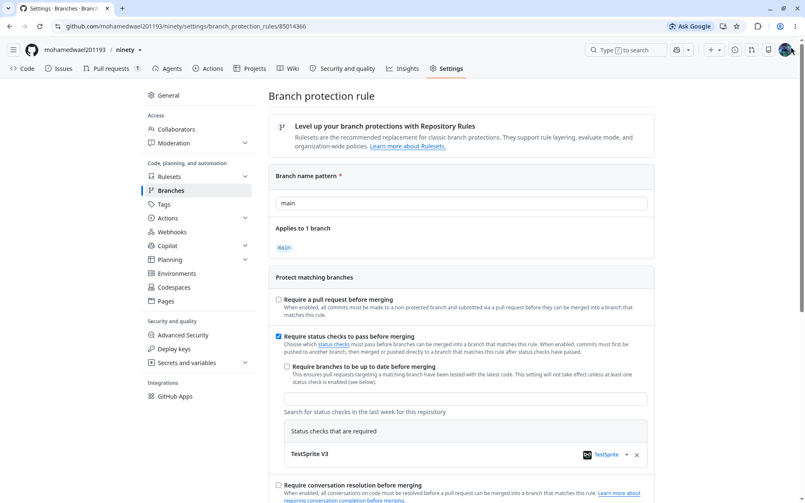 | GitHub branch protection on `main`: "Require status checks to pass before merging", with `TestSprite V3` (TestSprite app) as the required check. |
| 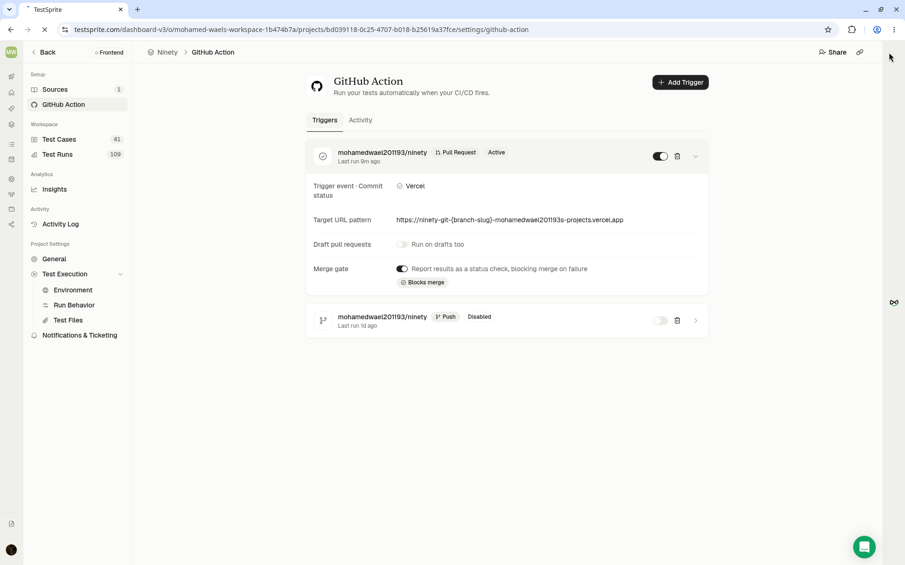 | TestSprite's GitHub trigger for `mohamedwael201193/ninety`. It fires on pull requests, on Vercel's commit status, and targets each PR's preview URL. The merge gate is on: "Report results as a status check, blocking merge on failure". The push trigger is disabled. |

## Red: TS45–TS52 on the commit that still had the bugs (78ee487)

| Screenshot | What it shows |
|---|---|
| 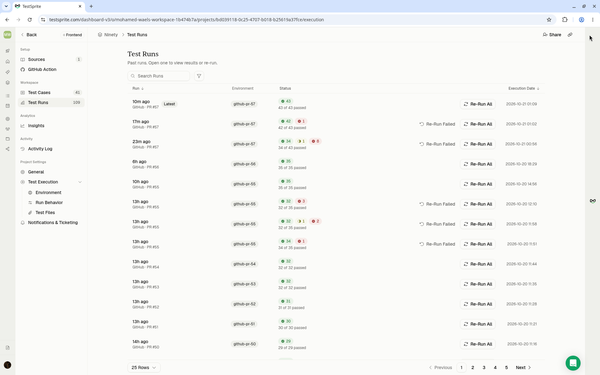 | The project's run list. PR #57 has three runs: 34/43 (8 failed, 1 blocked), then 42/43 (1 failed), then 43/43. Earlier PRs are listed below them. |
| 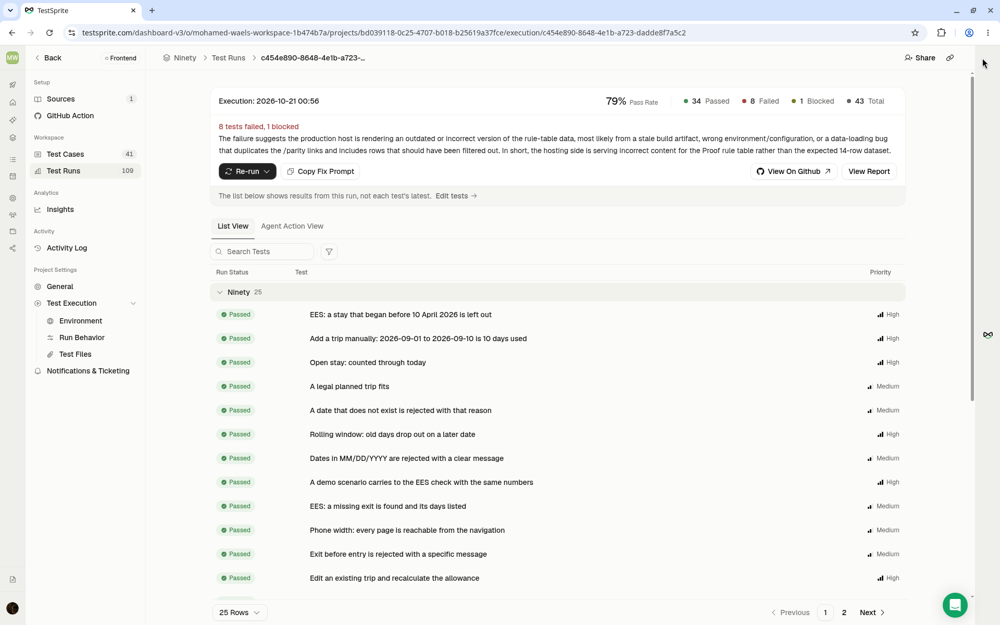 | The first PR #57 run: 79% pass rate, 34 passed, 8 failed, 1 blocked, 43 total. |
| 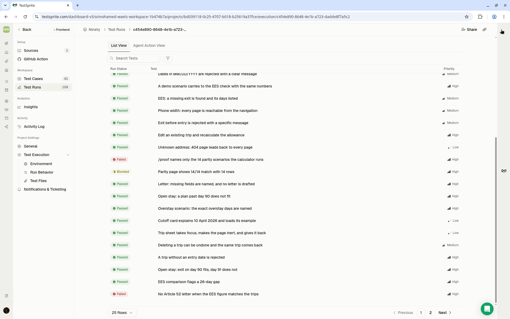 | Failed rows in that run: "/proof names only the 14 parity scenarios" (TS51) and "No Article 52 letter when the EES figure matches" (TS49). "Parity page shows 14/14" (TS02) is blocked. |
| 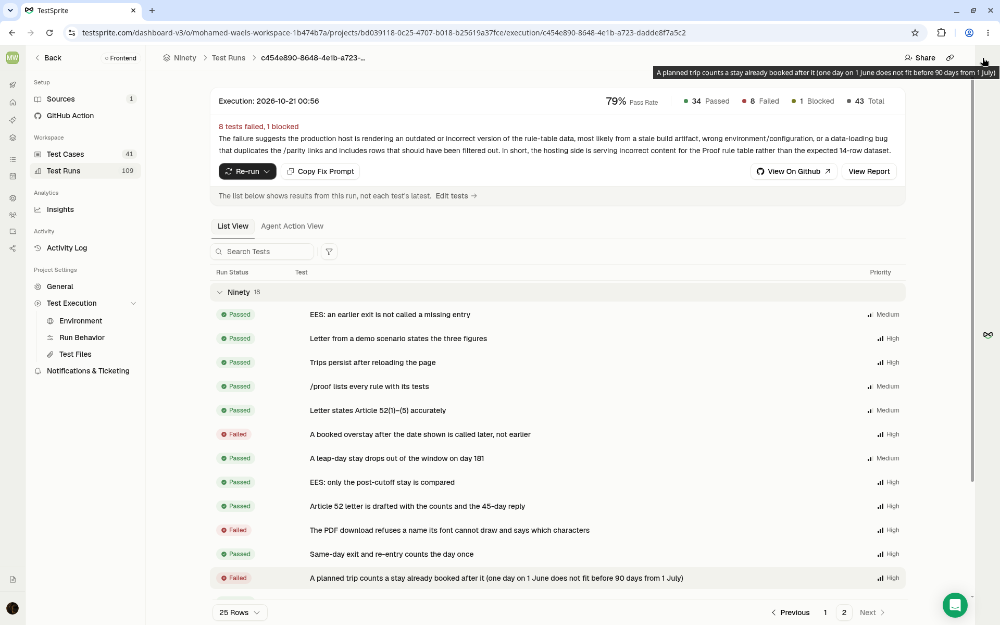 | Page 2 of the same run: TS52 (later overstay), TS50 (PDF font) and TS45 (planned trip) failed. |
| 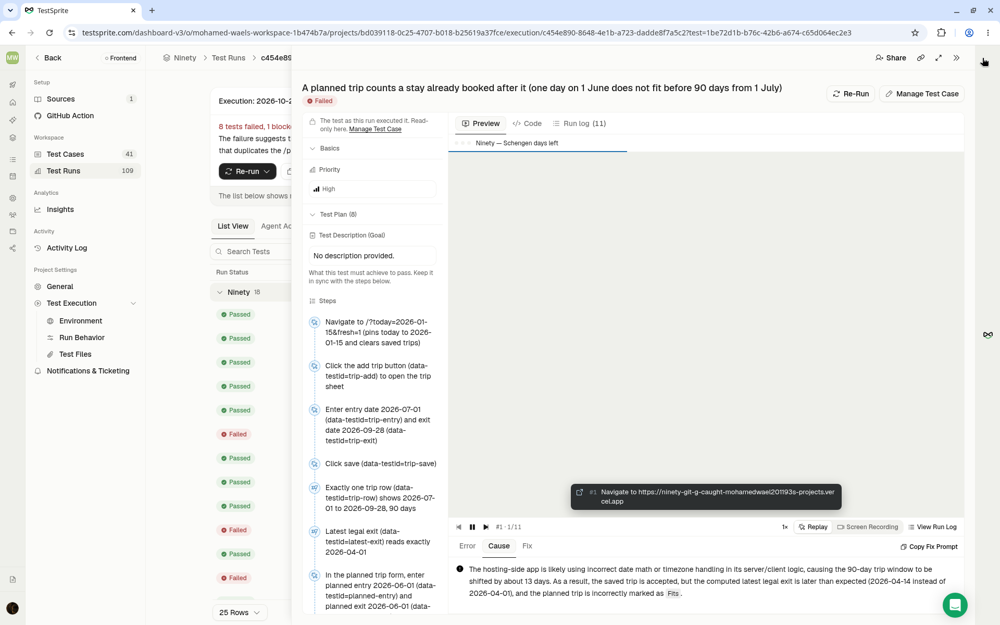 | TS45 opened. The plan steps on the left are the ones in `testsprite_tests/plans/TS45-plan-before-booked-stay.json`. TestSprite's cause names the bug's exact values: latest legal exit 2026-04-14 instead of 2026-04-01, and the planned trip marked "Fits". |

## The production bug TS02 caught (dae0081)

| Screenshot | What it shows |
|---|---|
| 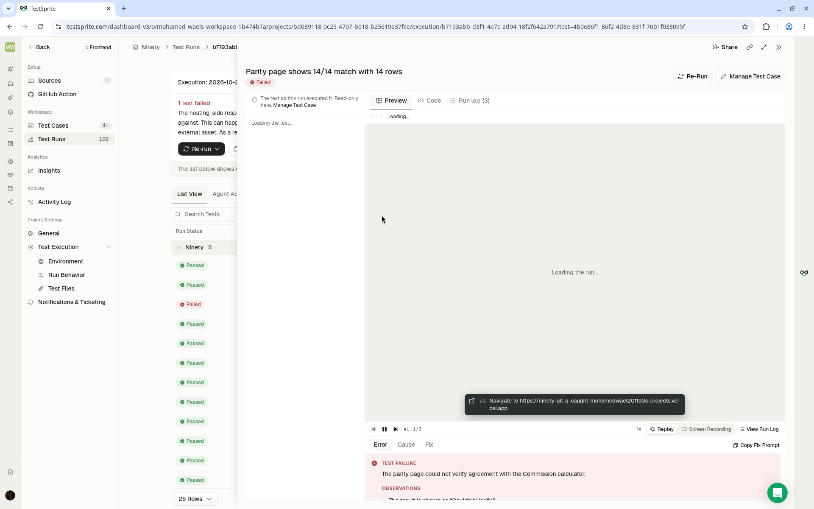 | The second run, after the fixes. TS02 "Parity page shows 14/14 match with 14 rows" failed: "The parity page could not verify agreement with the Commission calculator." The live Commission page did not come back as the calculator when fetched from Vercel, and production had the same problem. It was fixed in 1963cc1 by falling back to the stored, hash-checked copy, with a notice on the page. The replay pane was still loading when this was taken; the error text at the bottom is the run's verdict. |

## Green (1963cc1)

| Screenshot | What it shows |
|---|---|
| 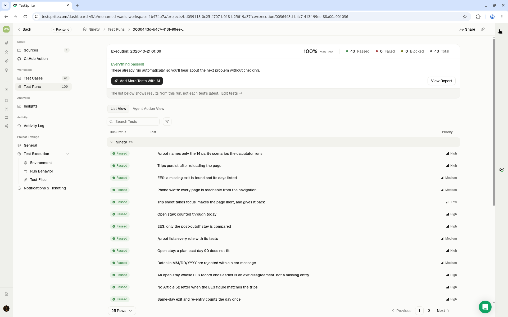 | The third run: 100%, 43 passed, 0 failed, 0 blocked, including TS45–TS52 and TS02. |
| 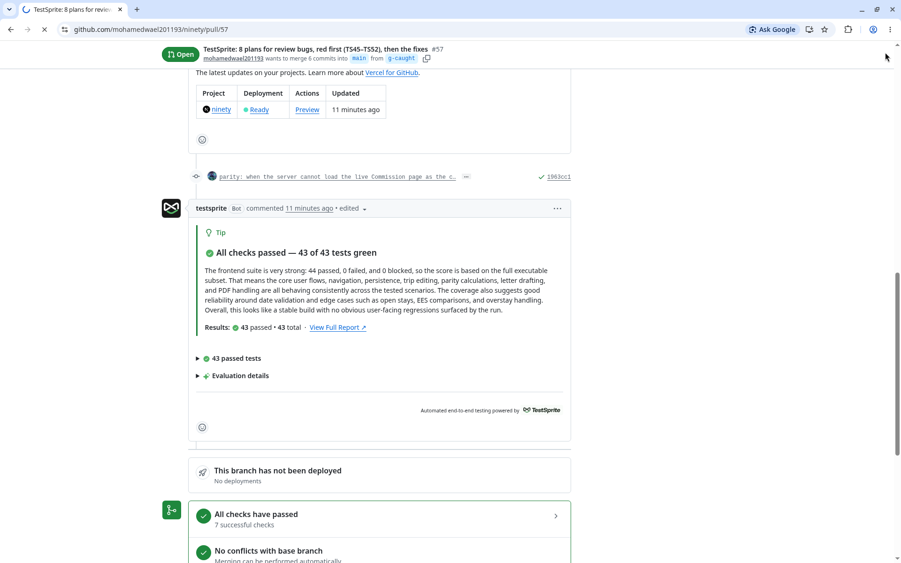 | The TestSprite bot comment on PR #57: "All checks passed — 43 of 43 tests green". Its AI-written summary says "44 passed"; the run and the status both say 43. |
| 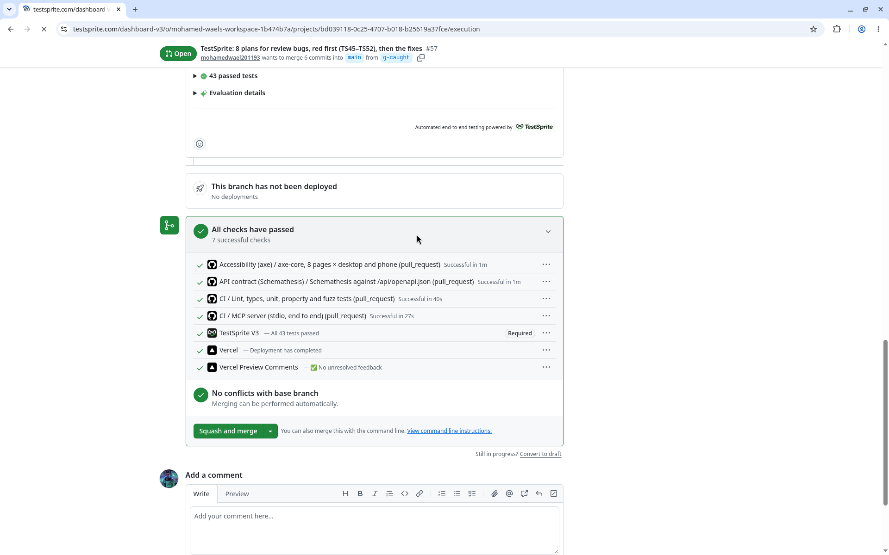 | The PR merge box: `TestSprite V3 — All 43 tests passed`, marked **Required**, next to CI, Schemathesis, axe and Vercel. The address bar shows the next page loading; the content is the GitHub PR. |
| 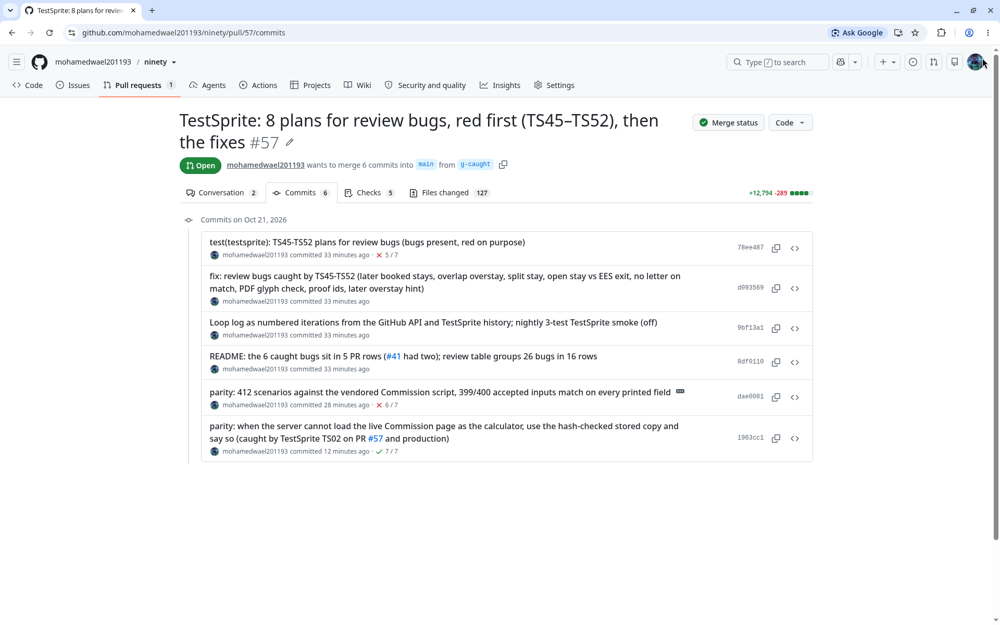 | PR #57's six commits, in order. The plans with the bugs present show ✗ 5/7. The fix commits follow. The last commit is the /parity fallback, ✓ 7/7. |
| 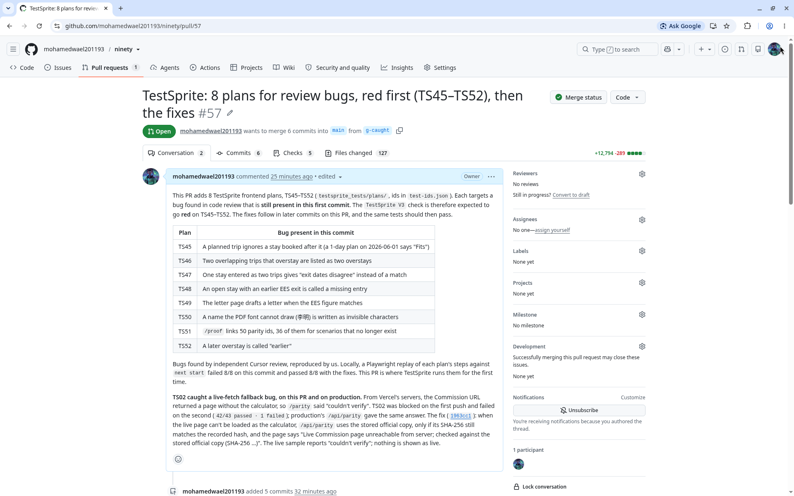 | The PR description: the table of the 8 bugs present in the first commit, and the paragraph on what TS02 caught. |

## Insights (stale)

| Screenshot | What it shows |
|---|---|
| 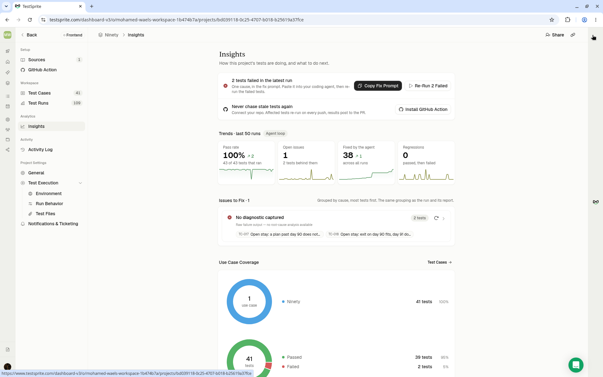 | The project's Insights page. **The banner at the top is stale:** "2 tests failed in the latest run" (two open-stay tests from earlier history) and "Install GitHub Action", although the GitHub trigger is installed and the latest run is 43/43. The trend tiles (100% pass rate, 43 of 43 that ran) and "41 tests" in the coverage donut are what the portal showed at the time; the cloud suite has 43 tests. |

One screenshot was left out: the GitHub Checks tab, which showed only Vercel's details pane and nothing about TestSprite.

## Backend tests (CLI, no screenshots)

There are 28 TestSprite backend tests in the "Ninety API" project. The first run was 27/28: BE28 caught a real bug, `/api/mcp` errors without an `id` member. After the fix, BE28 passed on its re-run. Run ids and results are in the main README's backend section. There are no portal screenshots for these yet.
